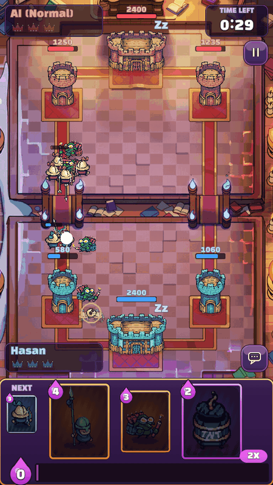
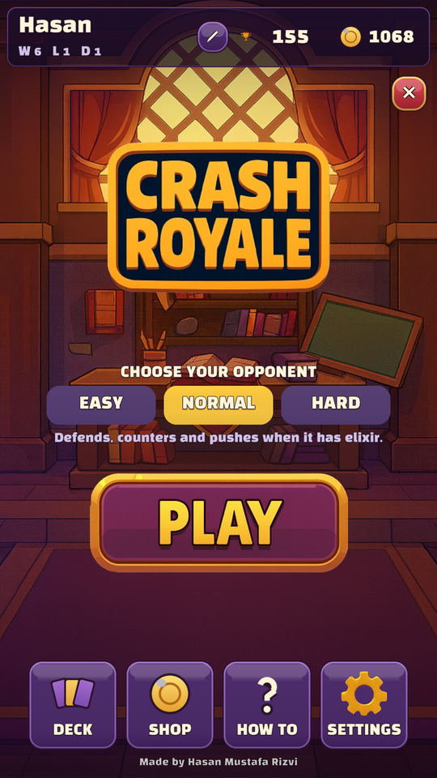
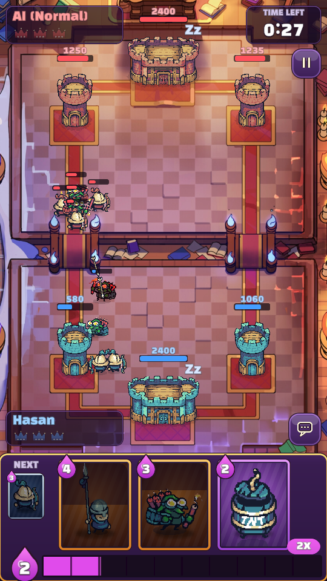
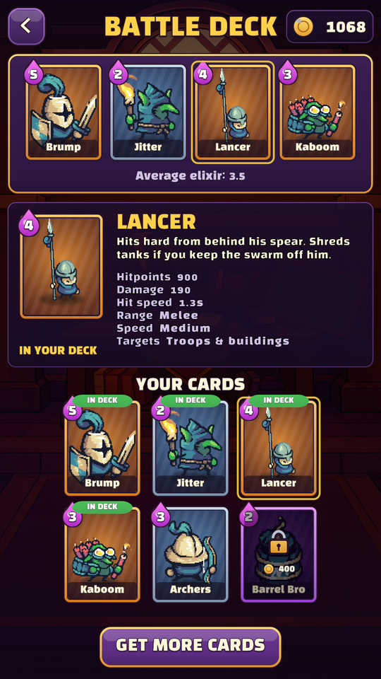
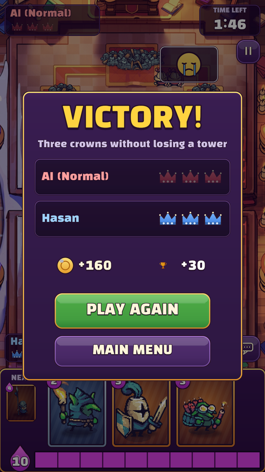

<h1 align="center">Crash Royale</h1>

<p align="center">
  A single-player parody of Clash Royale, made in Unity.<br>
  Drop troops, take towers, beat the bot.
</p>

<p align="center">
  
</p>

<p align="center">
  
  
  
  
</p>

## What it is

You and an AI opponent each get three towers, a hand of cards and a bar of elixir that fills over time. Cards cost
elixir and spawn troops that walk across the river and fight whatever they meet. Take a princess tower for a crown,
take the king tower to win on the spot. Two minutes on the clock, double elixir in the last minute, sudden-death
overtime if it's tied.

- **An opponent that plays by your rules.** The AI has its own deck, hand and elixir, and deploys through the exact
  same code path as you. No free troops, no peeking at your hand. Three difficulties.
- **Six cards:** Brump (tank), Jitter (goblin swarm), Lancer (melee damage), Kaboom (dynamite splash),
  Archers and Barrel Bro (a building-seeking bomb).
- **A deck builder and a shop.** Win gold, unlock cards and emotes, pick the four cards you take into battle.
- **Emotes**, because the bot should be able to laugh at you.
- Runs on Windows and in the browser (WebGL). Portrait like the real thing, and fine with a mouse. The Android
  build settings are in place too.

## Play

**[Play it in your browser](https://hasan-mustafa-rizvi.github.io/crash-royale/)**, or grab a Windows build from
[Releases](../../releases).

**Controls:** drag a card onto your half of the arena, or tap a card and then tap where it should go. The red area is
off limits. Esc pauses.

## The AI

Every second or so (more often on Hard) the bot does the first thing on this list that applies:

1. **Defend.** It picks the enemy group closest to one of its towers and runs a quick damage race: how long until its
   towers and troops kill the group, against how long until the group starts hitting the tower. If the tower would
   lose more health than the difficulty tolerates, it plays the best counter it can afford (splash for swarms, high
   damage for tanks, cheap cards for cheap threats) and places it where the tower can help.
2. **Pocket.** After it takes a princess tower, it drops building-hitters straight into the opened lane.
3. **Support.** When one of its troops is heading over the river, it backs it up from behind.
4. **Punish** (Hard only). It watches your elixir. Spend it all and it rushes the other lane.
5. **Push.** With enough elixir saved, it starts a push from the back, tank first, so the push builds as it walks.
6. **Don't leak.** Sitting at full elixir, it plays its cheapest card instead of wasting elixir.

| | Easy | Normal | Hard |
|---|---|---|---|
| Thinks every | 1.5 s | 0.8 s | 0.45 s |
| Reacts after | 1.6 s | 0.8 s | 0.2 s |
| Lets the tower take | a lot | some | little |
| Counter choice | often wrong, plays random cards | mostly right | always the best it has |
| Supports pushes, uses the pocket | no | yes | yes |
| Reads your elixir, plays the clock | no | no | yes |

The AI was tuned by having it play itself: the game has a built-in headless tournament mode (see
[Self-tests](#self-tests)) that plays hundreds of matches at high speed. With the current settings Hard beats Easy in
about 19 of 20 games, and beats Normal more than twice as often as it loses to it.

## Run it from source

1. Install **Unity 6000.2.13f1** (Unity 6.2) with Windows or WebGL build support (Android too, if you want an APK).
2. Clone the repo and open the folder in Unity Hub.
3. Open `Assets/Scenes/MainMenu.unity` and press Play.

Optional extras that can't be redistributed here:

- **Lancer sprites** from Pixel Frog's free Tiny Swords pack. Without them the Lancer uses a stand-in knight.
  See [`Assets/Art/ThirdParty/TinySwordsFreePack`](Assets/Art/ThirdParty/TinySwordsFreePack/README.md).
- **Music.** Drop two tracks in [`Assets/Audio/Music`](Assets/Audio/Music/README.md). Sound effects are included.

After adding either, run **Crash Royale > Rebuild Content and Scenes**.

To make builds: **Crash Royale > Build > Windows / Android APK / WebGL**. They all run headless too:

```
Unity -batchmode -quit -projectPath . -executeMethod CrashRoyale.EditorTools.GameBuilder.BuildWindows
```

## How it's put together

Almost everything is generated from code. **Crash Royale > Rebuild Content and Scenes** slices the sprite sheets,
builds the troop skins, prefabs, card data and all four scenes, and sets up the player settings. The scenes in the
repo are that output, so a change to the UI or a card is a change to a C# file, not a hand-edited scene.

```
Assets/Scripts
├── Battle/      match rules, towers, troops, pathing, the AI
├── Data/        cards, skins and the card database (ScriptableObjects)
├── UI/          HUD, card hand, deploy preview, menus, deck builder, shop
├── Meta/        player profile and save data
├── Audio/       sound library and the music/SFX player
├── Visual/      flipbook animation, health bars, camera
├── Editor/      the content and scene builders, build menu
├── Dev/         self-tests that ship inside desktop builds
└── Tests/       Edit Mode and Play Mode tests
```

The UI art (panels, buttons, card frames, icons, emotes) and every sound effect were generated by the Python scripts
in [`Tools/`](Tools/README.md), so they belong to the project and can be regenerated or changed.

A few details:

- One generic troop prefab. Each card is data: stats, targeting, attack type, skin and sounds.
- Troops route through the bridges, walk around towers, and push each other softly instead of colliding. A troop
  that's blocked for a moment squeezes past, so crowds never jam on a bridge.
- Damage lands on the hit frame of the attack animation, so what you see is when it hurts.
- Leaving a battle always restores the time scale, and nothing from a battle survives into the menus. Going between
  the menu and a battle is where the original build broke, so the self-tests below walk that path over and over.

## Self-tests

Desktop builds can test themselves. Start the game with one of these flags and it runs headless, writes a report and
quits. Without the flags none of this code runs.

```
CrashRoyale.exe -batchmode -nographics -crFlow            # clicks through every screen like a player (109 checks)
CrashRoyale.exe -batchmode -nographics -crSim 20          # AI vs AI tournament, every difficulty pairing
CrashRoyale.exe -batchmode -nographics -crMirror 40       # same decks from both sides, checks neither side has an edge
CrashRoyale.exe -batchmode -crShots                       # renders every screen to PNG
```

Add `-crOut <folder>` to choose where results go. Self-test runs use a throwaway profile and never touch your save.
Match logs come out as CSV, so balance changes can be checked with numbers instead of vibes. `-crTune` overrides AI
settings or card stats for one run, for example `-crTune Hard.Tolerance=150,kaboom.damage=140`.

The regular test suites are in `Assets/Scripts/Tests` and run from Unity's Test Runner.

## History

Crash Royale started as a team project for a Fundamentals of Software Engineering course in 2025. I wrote the
gameplay (troops, towers, combat, animation), [Jaedon Cox](https://www.linkedin.com/in/jaedon-cox/) built the login
page, and the rest of the team built the original menus. It was put together in about a week, and it showed: the
opponent didn't spawn troops on the same elixir rules as you, winning and losing didn't both work, the decks and
chests didn't carry into battles, and going between the menu and a battle could break the game.

In 2026 I rebuilt it into a complete game: the AI opponent, the full match rules, deck building and the shop wired into
battles, new UI and sound, and the self-test tooling.

## Credits

- Troops, towers and effects: [Tiny Swords](https://pixelfrog-assets.itch.io/tiny-swords) by Pixel Frog (CC0).
- Font: [Black Han Sans](https://fonts.google.com/specimen/Black+Han+Sans) (SIL Open Font License).
- UI, card frames, emotes and sound effects: made for this project.
- Arena and menu backgrounds, logo: AI-generated for the original class project.

Full list in [CREDITS.md](CREDITS.md).

Crash Royale is a fan-made parody. It is not affiliated with, endorsed by or connected to Supercell.
Clash Royale is a trademark of Supercell.

## License

Code: [MIT](LICENSE). Art, fonts and audio keep their own licenses, listed in [CREDITS.md](CREDITS.md).
